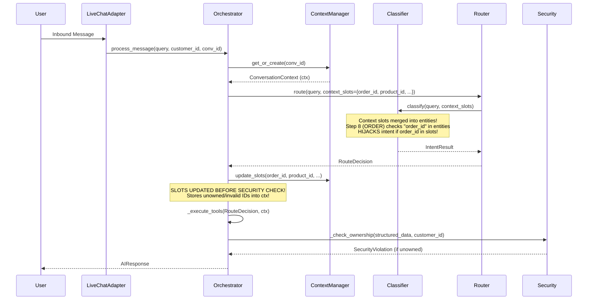

# Phase 13.2.1 — Multi-Turn Context Isolation Investigation (Read-Only Root Cause Analysis)

**Final Status**: `ROOT_CAUSE_IDENTIFIED`

---

## 1. Executive Summary

Phase 13.2.1 performed a comprehensive, read-only diagnostic investigation into multi-turn conversation context failures discovered during manual browser validation. Automated test suites currently report **266 / 266 PASS**, but manual verification revealed that entity context from prior turns can corrupt intent classification, tool argument resolution, and security authorization in subsequent turns.

Three distinct root causes were identified in the AI orchestration and context management architecture:

1. **Intent Classification Hijacking (`ai/intent.py`)**: `IntentClassifier` merges context slots into `entities` before evaluating classification rules. Step 8 (`ORDER_INQUIRY`) evaluates `if "order_id" in entities:` before Step 11 (`PRODUCT_INQUIRY`). Because `order_id` from prior turns remains in merged `entities`, explicit current product queries (e.g. `"What is the price of PROD-002?"`) are hijacked into `ORDER_INQUIRY`.
2. **Unsanitized Entity Persistence Before Security Authorization (`ai/orchestrator.py`)**: `AIOrchestrator` updates context slots (`ctx.update_slots()`) immediately after intent classification, *before* security ownership checks (`_check_ownership()`) are performed. When a customer queries an unowned order (e.g., `ORD-003` belonging to another customer), `active_order_id = "ORD-003"` is saved into context despite being blocked by security. On subsequent generic queries (e.g. `"Where is my shipment?"`), the dirty unowned order ID is used, resulting in false `Access Denied` responses.
3. **Cumulative Non-Expiring Slot Retention (`ai/context.py`)**: `ConversationContext.update_slots()` never expires or clears cross-domain entity slots when switching domains (e.g. Order $\rightarrow$ Product). Old entity slots linger indefinitely in memory for the duration of the conversation.

No production code, schema, or test files were modified during this investigation.

---

## 2. Current Context Architecture & Lifecycle

---

## 3. Detailed Trace of Confirmed Scenarios

### Scenario 1 & 2: Product $\rightarrow$ Order $\rightarrow$ Product Intent Hijacking
- **Sequence**:
  - Turn 1: `"What is the price of PROD-002?"` $\rightarrow$ `active_product_id = "PROD-002"`
  - Turn 2: `"What is the status of ORD-025?"` $\rightarrow$ `active_order_id = "ORD-025"`, `active_product_id = "PROD-002"`
  - Turn 3: `"What is the price of PROD-002?"`
- **Trace**:
  1. Turn 3 query explicit entity: `product_id = "PROD-002"`.
  2. Context slots passed into `classify()`: `order_id = "ORD-025"`, `product_id = "PROD-002"`.
  3. `classify()` merges context slots into `entities`: `{"product_id": "PROD-002", "order_id": "ORD-025"}`.
  4. Step 8 (`Order Queries`) checks: `if "order_id" in entities:`. This evaluates to `True`!
  5. Step 8 returns `ORDER_INQUIRY`. Step 11 (`PRODUCT_INQUIRY`) is **never reached**.
  6. Turn 3 incorrectly outputs Order ORD-025 details instead of Product PROD-002 details.

### Scenario 4: Cross-Customer Order Query Dirty Context Contamination
- **Sequence**:
  - Turn 1: `CUST-001` queries `"Where is shipment for ORD-003?"` (`ORD-003` belongs to `CUST-002`).
  - Turn 2: `CUST-001` queries `"Where is my shipment?"`
- **Trace**:
  1. Turn 1 query extracts `order_id = "ORD-003"`.
  2. `Orchestrator` calls `ctx.update_slots(order_id="ORD-003")` at line 74 **before** running ownership check.
  3. `_check_ownership()` rejects `ORD-003` and returns `Access Denied`.
  4. Turn 1 finishes with `ctx.active_order_id = "ORD-003"` persisted in memory.
  5. In Turn 2, `CUST-001` asks `"Where is my shipment?"`. `_execute_tools()` sees `order_id = ctx.active_order_id` (`"ORD-003"`), fetches `ORD-003` shipment, fails ownership check, and denies access to `CUST-001`'s own shipment!

---

## 4. Root Cause Evidence Matrix

| Component | File & Line | Cause Description | Evidence |
| :--- | :--- | :--- | :--- |
| **IntentClassifier** | `ai/intent.py:143-146`, `252` | Context slots are unconditionally merged into `entities`. Step 8 (`ORDER`) evaluates `"order_id" in entities` before Step 11 (`PRODUCT`). | `classify('What is the price of PROD-002?', slots={'order_id': 'ORD-025'})` returns `IntentCategory.ORDERS` instead of `PRODUCT`. |
| **AIOrchestrator** | `ai/orchestrator.py:74-79` | `ctx.update_slots()` is called immediately after routing, prior to ownership verification (`_check_ownership()`). | Querying unowned `ORD-003` persists `active_order_id = "ORD-003"` in `ctx` despite security denial. |
| **ConversationContext** | `ai/context.py:67-83` | Entity slots are cumulative and never expire or clear when explicit new domain entities arrive. | `active_order_id` and `active_product_id` coexist indefinitely without domain isolation. |

---

## 5. Security & Isolation Impact

- **Authorization Boundaries**: Security ownership checks (`_check_ownership()`) correctly block unowned data access when explicitly queried. However, because unowned IDs persist into `ctx`, subsequent valid generic queries by the legitimate user get locked out by the unowned context ID.
- **Data Security**: No unauthorized cross-customer data was leaked. However, availability for legitimate user queries was degraded (Denial of Service for own generic shipment/order lookups).

---

## 6. Recommended Minimal Fix (For Future Implementation Phase)

1. **Explicit vs Merged Entity Precedence in `IntentClassifier` (`ai/intent.py`)**:
   - Do not evaluate `"order_id" in entities` for `ORDER_INQUIRY` if `"order_id"` came purely from context slots while the current query has explicit product keywords or explicit non-order entities.
   - Alternatively, evaluate explicit current query intent keywords before relying on context slot presence.

2. **Atomic Security-Guarded Context Updates (`ai/orchestrator.py`)**:
   - Postpone `ctx.update_slots()` until AFTER `_check_ownership()` completes successfully. If a security violation occurs, do NOT persist the unauthorized entity IDs into `ctx`.

3. **Domain Slot Clearing / Expiration (`ai/context.py`)**:
   - When an explicit new domain entity is extracted (e.g. explicit `product_id`), clear conflicting non-explicit entity slots or manage slot precedence so orders don't override explicit product queries.

---

## 7. Verification Matrix

| Scenario | Query Sequence | Expected Result | Observed Result | Status |
| :--- | :--- | :--- | :--- | :---: |
| **Scenario 1** | Price PROD-002 $\rightarrow$ Status ORD-025 $\rightarrow$ Price PROD-002 | Product $\rightarrow$ Order $\rightarrow$ Product | Product $\rightarrow$ Order $\rightarrow$ Order | ❌ **ROOT CAUSE IDENTIFIED** |
| **Scenario 2** | PROD-001 $\rightarrow$ Shipment $\rightarrow$ PROD-001 $\rightarrow$ ORD-025 $\rightarrow$ Price PROD-002 | Product $\rightarrow$ Shipment $\rightarrow$ Product $\rightarrow$ Order $\rightarrow$ Product | Product $\rightarrow$ Shipment $\rightarrow$ Product $\rightarrow$ Order $\rightarrow$ Order | ❌ **ROOT CAUSE IDENTIFIED** |
| **Scenario 3** | Status ORD-025 $\rightarrow$ Price PROD-002 | Order $\rightarrow$ Product | Order $\rightarrow$ Order | ❌ **ROOT CAUSE IDENTIFIED** |
| **Scenario 4** | Shipment ORD-003 (Unowned) $\rightarrow$ Where is my shipment? | Denied $\rightarrow$ Own Shipment (SHIP-025) | Denied $\rightarrow$ Denied (Dirty ORD-003 context) | ❌ **ROOT CAUSE IDENTIFIED** |
| **Scenario 5** | Tell me about PROD-002 $\rightarrow$ What is its price? | Product $\rightarrow$ Product (using context) | Product $\rightarrow$ Product | PASS |
| **Scenario 6** | Status ORD-025 $\rightarrow$ What carrier is handling it? | Order $\rightarrow$ Order/Shipment | Order $\rightarrow$ Order/Shipment | PASS |

---

## 8. Final Status

`ROOT_CAUSE_IDENTIFIED`
